<div align="center">


# Kintsugi

**A robot that builds its own skills, and proves they work.**

[](https://youtu.be/abXK6yvgmlE)

[▶ Watch the 3-minute demo](https://youtu.be/abXK6yvgmlE) · Built on Meta's Muse Spark, SAM 3.1 and Muse Image ·
No training · No GPU · Runs on a laptop

</div>

---

<p align="center">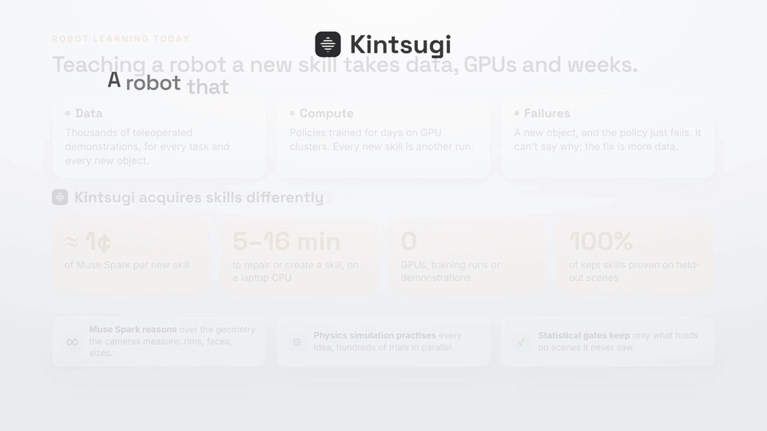</p>

Kintsugi is a robotics studio in which a robot arm builds and verifies its own skills. You describe a task in plain
words, or show it a photo of your table. Muse Spark plans it and the robot runs it in physics simulation. When a step
fails, Muse Spark **investigates why**, the robot **practises on that failure**, and a new skill is **kept only if it
works on scenes it has never seen and breaks nothing that worked before**. Every verified skill joins a library that
the robot reuses on new objects, and when a skill is missing, Muse Spark writes it.

<p align="center">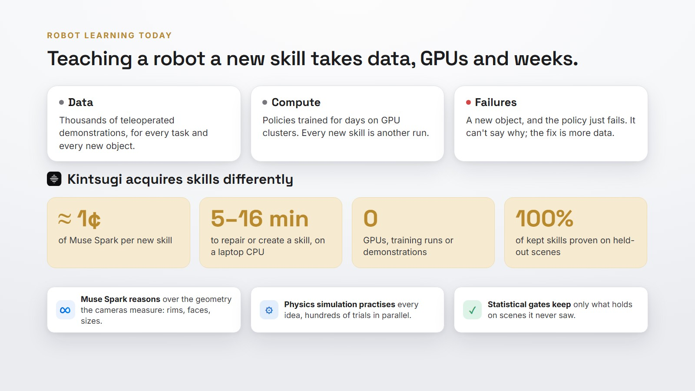</p>

## Contents

[See it work](#see-it-work) · [How it works](#how-it-works) · [The core engine](#the-core-engine) ·
[Results](#results) · [Built with Meta models](#built-with-meta-models) · [Architecture](#architecture) ·
[Setup](#setup) · [Command-line tools](#command-line-tools)

## See it work

### Describe a task: Muse Spark plans it, many scenes run at once

<p align="center"></p>

Every Muse Spark call appears live in the panel at the top right, with its model, duration, tokens, endpoint and the
request ID returned by the Meta Model API.

### Start from a photo of your table

<p align="center"></p>

Muse Spark reads the scene and proposes a task, SAM 3.1 finds each object, and Muse Image rebuilds the tabletop. The
robot then works in a digital twin of your own workspace.

### No skill for it? Muse Spark writes one, and the gates prove it

<p align="center"></p>

Asked to open a cabinet door it has no skill for, the robot fails every scene. Muse Spark writes three candidate
skills as code, search tries and tunes them in physics, and the best one passes the gates. Running the task again,
every scene succeeds (15 minutes of real time, shown as a time-lapse).

## How it works

<p align="center">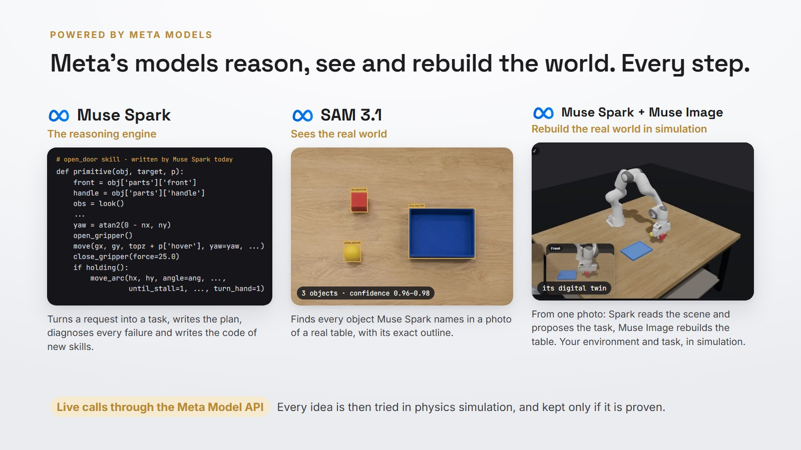</p>

<p align="center">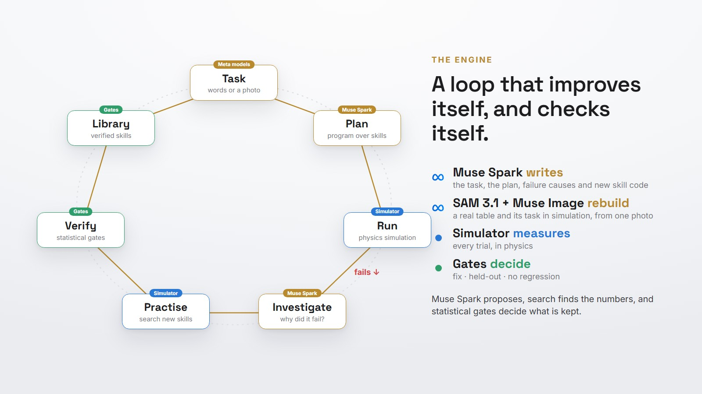</p>

When a step fails, the same loop runs every time:

| 1 · It fails | 2 · It investigates |
|---|---|
| 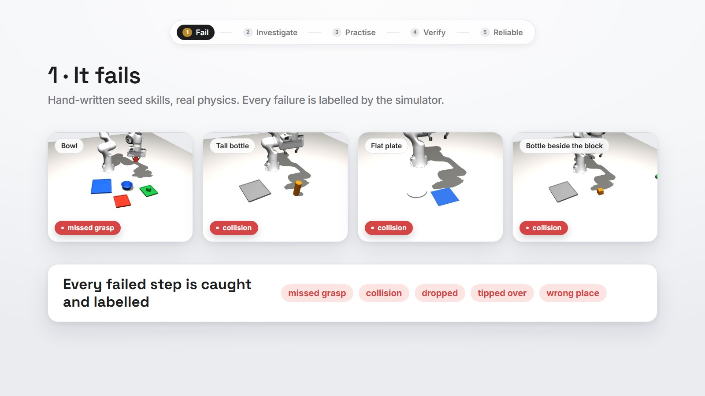 | 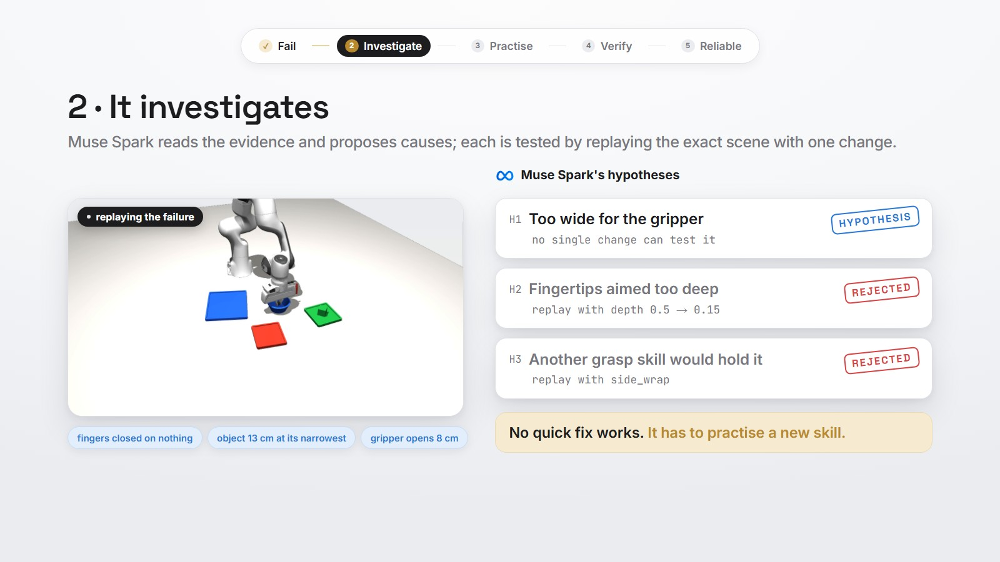 |
| **3 · It practises on the failure** | **4 · It keeps only what is proven** |
| 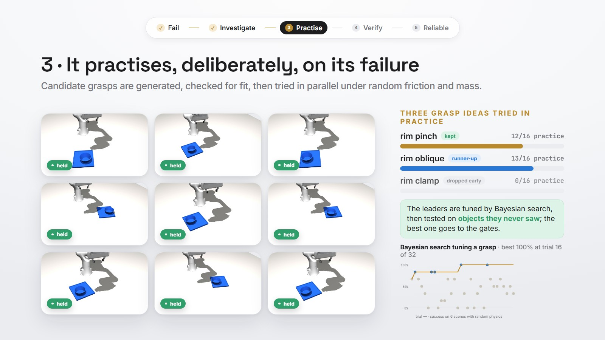 | 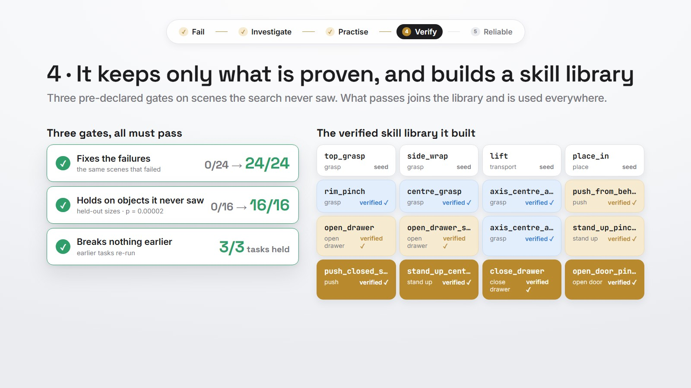 |

## The core engine

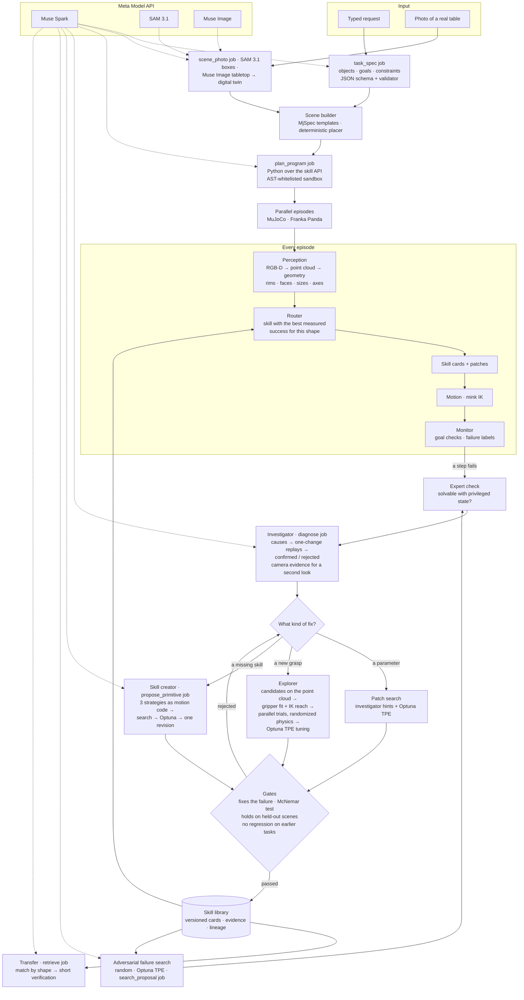

**Model jobs.** Every call to Muse Spark is a registered job with a versioned prompt, a JSON schema and a semantic
validator. An invalid answer gets the validator's errors fed back once, then it is rejected with the reasons. Every
answer is cached and logged with its model, prompt version and tokens.

| Job | What Muse Spark does | Checked by |
|---|---|---|
| `task_spec` | turns a request into objects, goals and constraints, or asks a clarifying question, or refuses | schema, template ranges, the scene must be placeable |
| `scene_photo` | reads a photo: each object as a template with a label, a rough box and its real width, plus a task | schema; SAM 3.1 then locates each object |
| `plan_program` | writes a short Python program over the perception and skill API | AST whitelist, known names only, call budget |
| `diagnose` | proposes up to three failure causes, each with one test (a parameter, the object, or another skill) | every cause is replayed with that one change |
| `propose_primitive` | writes a missing skill as motion code over the robot's API, in three different strategies | sandbox, then search, tuning and the gates |
| `search_proposal` | proposes where in the space of scenes the library is likely to fail | the expert check and the simulator |
| `retrieve` | picks a library skill for an unseen object from its measured shape | a short verification run |

**What is searched, and what decides.** Muse Spark proposes. The numbers (grasp offsets, depths, angles, speeds) are
found by search: candidates are generated on the point cloud, filtered by gripper fit and inverse-kinematics reach,
tried in parallel under randomized friction and mass, and tuned by Bayesian search (Optuna's TPE sampler). A change is
kept only if pre-declared statistical gates pass, judged on scenes the search never used. Skills see only what the
cameras measure and the robot's own joints; the simulator's true state is used only to grade outcomes and label
failures.

## Results

All numbers are measured in simulation on fixed seeds, with held-out objects never used for tuning
(`python scripts/headlines.py` reproduces them).

<p align="center">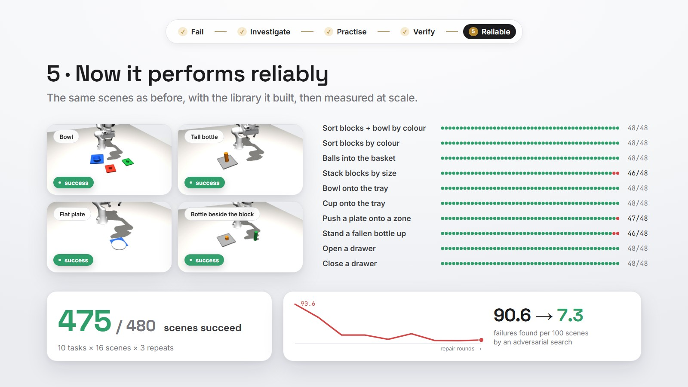</p>

<p align="center">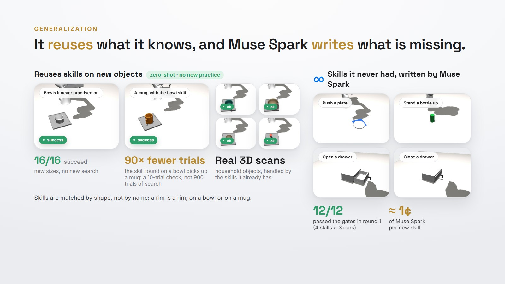</p>

| | |
|---|---|
| **Reliability** | **475 / 480** scenes succeed across 10 tasks (sorting, stacking, pushing, standing objects up, opening and closing drawers), 3 repeats |
| **Self-repair** | bowl wider than the gripper: **0/24 → 24/24**, held-out bowls **0/16 → 16/16**, in about 5 minutes on a laptop |
| **Zero-shot transfer** | the skill found on a bowl picks up an unseen mug: a **10-trial check** instead of **900** trials of search from scratch (9/10 succeed) |
| **New skills from scratch** | Muse Spark wrote push, stand-up, open-drawer and close-drawer skills; **all passed the gates in round 1**, in each of 3 repeats, for about a cent each |
| **Diagnosis** | Muse Spark names the right failure cause **87.5%** of the time, and every proposed cause is tested |
| **Failure search** | adversarial search finds **90.6** failures per 100 scenes on the seed library, **7.3** after the repair rounds |
| **Photo to scene** | 16 test photos: **70/70** objects found, **282/282** left/right and front/behind relations kept |

## Built with Meta models

Every model the software calls is a Meta model, reached through the **Meta Model API** (`https://api.meta.ai/v1`).
The simulation, search and statistics are ordinary code on the CPU.

| Model | Model ID | Endpoint | What it does here |
|---|---|---|---|
| **Muse Spark** | `muse-spark-1.3` by default (any ID your key lists, set in Settings) | `POST /chat/completions` | task specs, clarifying questions and refusals; plan programs; failure diagnosis (with images when stuck); failure-search proposals; skill retrieval; new skill code |
| **SAM 3.1** | `sam-3.1` | `POST /responses` | finds each object in a real photo |
| **Muse Image** | `muse-image-1.0` | `POST /images/edits` | rebuilds the empty tabletop from a photo, for the digital twin |

A rule-based offline mode runs the standard tasks with no model at all.

### Checking the model calls

- **In the app:** the *Meta model calls* panel (top right) lists every call as it happens: model ID, what it is doing,
  real duration and tokens. Click a call to see its endpoint and the request ID returned by the Meta Model API.
- **On disk:** `cache/llm/live_calls.jsonl` has one start and one end line per call (model, endpoint, request ID,
  duration, tokens, errors), including calls made by Studio jobs. `cache/llm/calls.jsonl` logs every answer with its
  job, prompt version and validation repairs. Cached answers make no call and are marked `cached`.
- Run the server with `KINTSUGI_NO_CACHE=1` to make every request a fresh call.

## Architecture

<p align="center">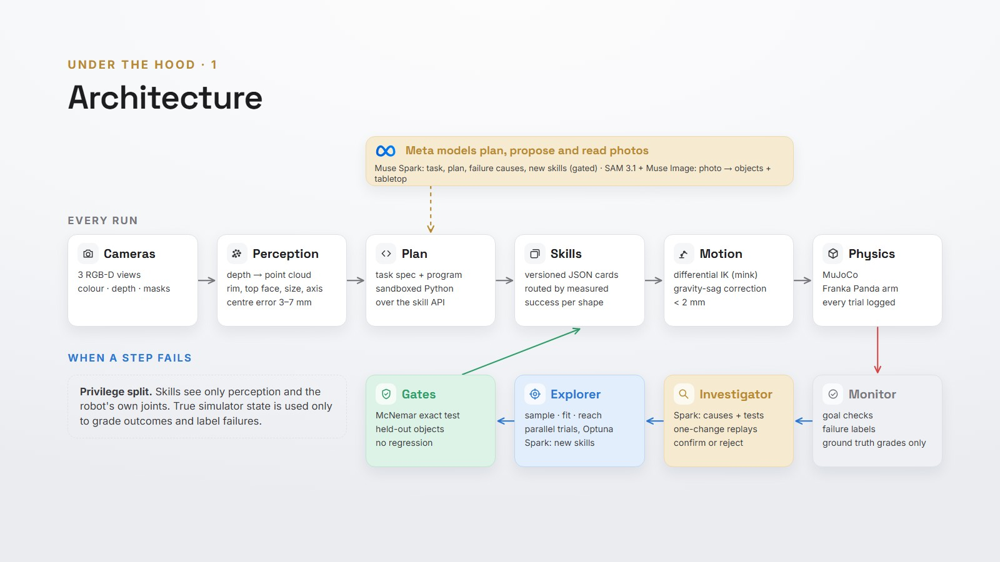</p>

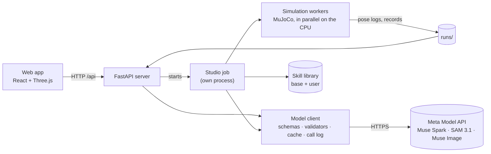

- **Web app** (`web/`, React + Vite + react-three-fiber): the Studio, Episodes, Progress, Investigator, Experiments and
  Skills pages. Physics never runs in the browser; it replays recorded poses and live frames.
- **Server** (`server/app.py`, FastAPI): serves runs, skills and settings, starts one Studio job at a time in its own
  process, and streams progress and live frames.
- **Engine** (`kintsugi/`): simulation and scene templates (`sim/`), perception, skills and router (`skills/`), the
  executor and the plan-program sandbox, the investigator, the explorer and failure search (`search/`), the skill
  creator and reviser, auto-repair, the photo twin, and one model client for every job (`agents/`).
- **Skill library**: `skill_library/` is the base library (tracked in git); everything the robot discovers on your
  machine goes to `user_library/` (git-ignored). `scripts/skills.py` exports skill packs and imports or contributes them
  through the same re-verification gate.
- **Keys** stay on your computer in `config/local.json` (git-ignored) and are shown only as their last four characters.
- **Third-party parts (not AI models):** MuJoCo, the Franka Panda model from MuJoCo Menagerie, mink (inverse
  kinematics), Optuna (Bayesian search), Google Scanned Objects (household object meshes), FastAPI, React and three.js.
  Everything else in this repository was written for this project.

## Setup

**You need:** Python 3.11, Node.js 18 or newer, git, about 1 GB of disk, and (for the Meta models) a Meta Model API
key. Windows, macOS or Linux; no GPU.

### 1 · Get the code and a Python environment

```bash
git clone https://github.com/0xE1G/sensei.git kintsugi
cd kintsugi
```

With conda:

```bash
conda create -n kintsugi python=3.11 -y
conda activate kintsugi
```

Or with a plain virtual environment:

```bash
python -m venv .venv
source .venv/bin/activate        # Windows: .venv\Scripts\activate
```

### 2 · Install and download the robot

```bash
pip install -r requirements.txt
python scripts/fetch_assets.py              # the Franka Panda model from MuJoCo Menagerie
python scripts/fetch_assets.py --scanned    # optional: 32 scanned household objects (~50 MB)
python scripts/smoke_test.py                # about a minute; ends with "32/32 passed"
```

### 3 · Start the app

Build the web app once, then one command runs everything:

```bash
cd web && npm install && npm run build && cd ..
python -m uvicorn server.app:app --port 8000
```

Open **http://localhost:8000**.

<details>
<summary>Developing the web app instead (hot reload, two terminals)</summary>

```bash
python -m uvicorn server.app:app --port 8000     # terminal 1: the API and the simulation jobs
cd web && npm install && npm run dev             # terminal 2: open http://localhost:5173
```
</details>

### 4 · Add your Meta Model API key

Click **Settings** (top right), paste your key under **Meta Model API → API key**, click **Save**, then
**Test connection**. The address (`https://api.meta.ai/v1`) and the model (`muse-spark-1.3`) are already filled in;
change them under *Advanced* only if your key uses others. The same key gives access to Muse Spark, SAM 3.1 and Muse
Image.

<p align="center"></p>

The key is stored only in `config/local.json` on your computer, which is never committed. You can also set it in the
environment instead (it then wins over the settings file):

```bash
export META_API_KEY="your-key"                 # Windows PowerShell: $env:META_API_KEY = "your-key"
export META_MODEL="muse-spark-1.3"             # optional
```

**No key yet?** Choose **Offline rules** in Settings to try the standard tasks with built-in rules and no model calls.

### 5 · Try it

1. In the **Studio**, type `Sort the blocks and the bowl onto the trays of the same colour.` and press **Enter**.
   Muse Spark writes the task and the plan; check the 3D preview, then click **Run**.
2. Click **Photo** and attach a picture of a table with a few objects; leave the request empty and Muse Spark proposes
   one.
3. Try `Open the cabinet door.` With **Fix failures automatically** on (the default), the robot creates the missing skill (about 15 minutes on
   a laptop) and runs the task again.
4. Open **Episodes** to replay any scene, **Investigator** to read every diagnosis, and **Skills** to see each skill
   with its evidence and history.

### Troubleshooting

- **Headless Linux:** set `MUJOCO_GL=egl` (or run under `xvfb-run -a` with `MUJOCO_GL=glfw`).
- **Port 8000 busy:** use `--port 8001` and open that port instead.
- **Slow on a small machine:** lower **In parallel** in the Studio's run settings (default: CPU cores − 1, at most 8).
- **"Test connection" fails:** check the key, and that your key lists the model ID shown under *Advanced*.

## Command-line tools

```bash
python scripts/run_task.py sort_with_bowl -n 8 --oracle          # a named task; the expert checks each scene was solvable
python scripts/prompt_task.py "Put the bowl on the tray." -n 4 --backend spark
python scripts/explore.py sort_with_bowl --from-seed --dry-run   # the full repair loop on the demo failure
python scripts/failure_search.py --from-seed                     # where does the library fail? random vs Optuna vs model
python scripts/investigate.py --from-search runs/<id>_failsearch/report.json --library current
python scripts/create_skill.py push --task slide_plate --backend spark   # write, search, tune and gate a missing skill
python scripts/transfer.py mug --backend spark                   # reuse a skill on an unseen object type
python scripts/auto_repair.py runs/<id>                          # repair the failures of ordinary runs
python scripts/twin_eval.py --photos <folder>                    # photo -> digital twin, on your own photos
python scripts/skills.py list                                    # the skill library (base + local discoveries)
python scripts/headlines.py                                      # every headline number into one table
```

Every run writes to `runs/<time>_<task>/`: a summary with confidence intervals, one JSON record per trial (seed,
plan, skill trace, checks, failure label), and videos and pose logs for replay.

## Project layout

```
kintsugi/
  sim/          scene building (MjSpec templates, scanned and imported objects), recorder, monitor (goal checks, labels)
  perception/   cameras, depth -> point cloud -> geometric object descriptors, SAM 3.1 client
  skills/       skill cards, router, base and user libraries
  agents/       one model client (Muse Spark / offline rules), versioned prompts, schemas, validators, call log
  search/       repair loop (explorer), adversarial failure search
  executor.py   episodes: perceive -> plan -> skills -> checks -> labels
  program.py    sandboxed plan programs over the skill API
  investigate.py, create_skill.py, revise_skill.py, auto_repair.py, twin.py, studio.py
skill_library/  the base library: versioned skill cards with parameters, preconditions, evidence and lineage
server/         FastAPI backend (runs, Studio jobs, settings, live model calls)
web/            React + Three.js app (physics never runs in the browser: it replays recorded poses)
scripts/        command-line tools; smoke_test.py runs after every change
```

## Limitations

- Results are verified **in simulation** (MuJoCo, Franka Panda); real-robot transfer is not shown.
- Success must be checkable by code (on, in, upright, opened, distances), so tasks like pouring liquids or folding
  cloth are out of scope.
- Photo positions are estimates from a single image without depth (about 3 cm on test photos).

## Acknowledgements

Robot model from [MuJoCo Menagerie](https://github.com/google-deepmind/mujoco_menagerie) (Apache-2.0). Household
objects from [Google Scanned Objects](https://research.google/blog/scanned-objects-by-google-research-a-dataset-of-3d-scanned-common-household-items/)
(CC-BY 4.0) via [mujoco_scanned_objects](https://github.com/kevinzakka/mujoco_scanned_objects) (MIT). Inverse
kinematics with [mink](https://github.com/kevinzakka/mink); Bayesian search with [Optuna](https://optuna.org).
