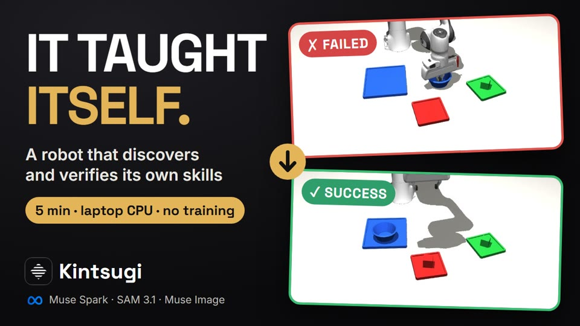
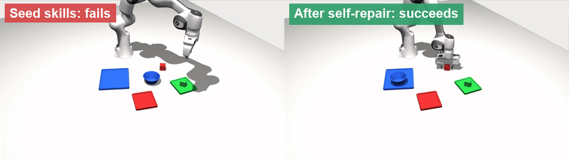
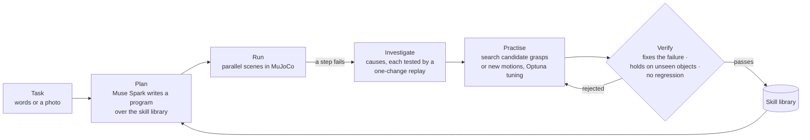
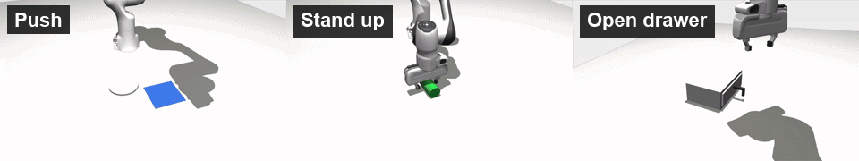

<div align="center">

# Kintsugi

**Robots that teach themselves new skills, and prove they work.**

[](https://youtu.be/zoBb1hVsLBc)

[▶ Watch the 4-minute demo](https://youtu.be/zoBb1hVsLBc) · No training · No GPU · Runs on a laptop CPU

</div>

---

A robot arm is given a task in plain words, or a photo of a table. It builds the scene, writes a plan and runs it in
simulation. When a step fails, it does not guess. It **investigates why**, **practises on that exact failure**,
searching hundreds of candidate motions, and **keeps a fix only if it holds on objects it has never seen and breaks
nothing that worked before**. Every verified fix becomes a skill in a growing library, and those skills transfer to new
objects.

<p align="center"></p>
<p align="center"><sub>The same scene, before and after: the robot found a rim grasp for a bowl wider than its gripper,
in about five minutes on a laptop.</sub></p>

## Why it matters

Language models can write robot code zero-shot, and on easy cases that works. But they cannot tell when that code is
wrong, so on a harder object it fails, silently, the same way every time.

Kintsugi uses zero-shot whenever it works, and adds what that is missing: it **measures** every attempt, **repairs**
what fails, and **verifies** every change with statistics before it is trusted. The language model proposes plans,
causes and new skills; it never grades its own work. The simulator measures, and pre-declared statistical gates decide.

## How it works



- **Skills are defined on shapes, not names** (a rim, a top face, a long axis), so a skill found on a bowl works on an
  unseen mug after a short verification.
- **Skills only see what the cameras see.** True simulator state is used only to grade outcomes and to check that a
  failure was solvable at all.
- **Missing capabilities are written, then earned.** When no skill can do a task (pushing a plate, standing a bottle up,
  opening a drawer), Muse Spark writes candidate motion code; search tunes it and the same gates verify it.

## Results

All numbers are measured in simulation on fixed seeds, with held-out objects never used for tuning
(`python scripts/headlines.py` reproduces them).

| | |
|---|---|
| **Reliability** | **475 / 480** scenes succeed across 10 tasks (sorting, stacking, pushing, standing objects up, opening and closing drawers), 3 repeats |
| **Self-repair** | bowl wider than the gripper: **0/24 → 24/24**, held-out bowls **0/16 → 16/16**, in about 5 minutes |
| **Zero-shot transfer** | unseen mug: **10 verification trials** with the library vs **900** from scratch (9/10 succeed) |
| **New skills from scratch** | Muse Spark wrote push, stand-up, open- and close-drawer skills; **all passed the gates in round 1**, in each of 3 repeats, for about a cent each |
| **Diagnosis** | Muse Spark names the right failure cause **87.5%** of the time, and every proposed cause is tested |
| **Failure search** | an adversarial search finds **90.6** failures per 100 scenes on the seed library, **7.3** after the repair rounds |
| **Photo to scene** | 16 test photos: **70/70** objects found, **282/282** left/right and front/behind relations kept |

## Features

### The Studio: from a sentence to the robot doing it

Type a task. Muse Spark writes the task spec and a plan program; the scene is built and eight copies run in parallel
on the CPU, streaming live into a 3D view. If steps fail, the Studio diagnoses them, searches for a fix, gates it and
runs the same scenes again.

<p align="center"></p>

### Start from a photo of your table

Attach a photo (the request is optional). Muse Spark lists the objects and proposes a task, **SAM 3.1** finds each
object's exact position, and **Muse Image** removes the objects from the photo to recreate the real tabletop. The robot
then works in a digital twin of your workspace.

<p align="center"></p>

### Skills that did not exist

<p align="center"></p>

### And around it

- **Episodes:** replay any trial, step by step, with the robot's own camera views and a clickable skill timeline.
- **Investigator:** every hypothesis, the one-change test that checked it, and the verdict: confirmed, rejected or
  inconclusive.
- **Experiments:** every search and every gate decision, with paired statistical tests.
- **Skills:** each skill as a verified card, with where it works, its evidence and its full history.
- **Skill packs:** export skills, and import or contribute them through the same re-verification gate.

## Built with Meta models

| Model | What it does here |
|---|---|
| **Muse Spark** | task specs, clarifying questions and refusals; plan programs; failure diagnosis; failure-search proposals; new skill code |
| **SAM 3.1** | finds each object in a real photo |
| **Muse Image** | recreates the empty tabletop from a photo |

Every model output is schema-validated, cached and logged. A rule-based offline mode runs the standard tasks with no
model at all, and Claude can serve as a fallback.

## Quick start

Requirements: Python 3.11, Node.js 18+, about 1 GB of disk. Windows, macOS or Linux; no GPU.

```bash
git clone https://github.com/0xE1G/sensei.git kintsugi && cd kintsugi
conda create -n kintsugi python=3.11 -y && conda activate kintsugi
pip install -r requirements.txt
python scripts/fetch_assets.py              # the Franka Panda model (MuJoCo Menagerie)
python scripts/fetch_assets.py --scanned    # optional: 32 scanned household objects (~50 MB)
python scripts/smoke_test.py                # about a minute; should end with "passed"
```

Run the app:

```bash
uvicorn server.app:app --port 8000          # the API (and the simulation jobs)
cd web && npm install && npm run dev        # open http://localhost:5173
```

Or build the web app once (`cd web && npm run build`) and open http://localhost:8000.

Then open **Settings** (top right) and paste your Meta Model API key. It is stored only on your computer
(`config/local.json`, never committed). Without a key, choose **Offline rules** to try the standard tasks.

On a headless Linux server, set `MUJOCO_GL=egl` (or run under `xvfb-run` with `MUJOCO_GL=glfw`).

## Command-line tools

```bash
python scripts/run_task.py sort_with_bowl -n 8 --oracle          # a named task; the oracle checks each scene was solvable
python scripts/prompt_task.py "Put the bowl on the tray." -n 4 --backend spark
python scripts/explore.py sort_with_bowl --from-seed --dry-run   # the full repair loop on the demo failure
python scripts/failure_search.py --from-seed                     # where does the library fail? random vs Optuna vs model
python scripts/investigate.py --from-search runs/<id>_failsearch/report.json --library current
python scripts/create_skill.py push --task slide_plate --backend spark   # write, search, tune and gate a missing skill
python scripts/transfer.py mug --backend spark                   # reuse a skill on an unseen object type
python scripts/auto_repair.py runs/<id>                          # repair the failures of ordinary runs
python scripts/twin_eval.py --photos <folder>                    # photo -> digital twin, on your own photos
python scripts/skills.py list                                    # the skill library (base + local discoveries)
python scripts/headlines.py                                      # every headline number into one table
```

Every run writes to `runs/<time>_<task>/`: a summary with confidence intervals, one JSON record per trial (seed,
plan, skill trace, checks, failure label), and videos and pose logs for replay.

## Project layout

```
kintsugi/
  sim/          scene building (MjSpec templates, scanned and imported objects), recorder, monitor (goal checks, labels)
  perception/   cameras, depth -> object descriptors, SAM 3.1 client
  skills/       skill cards, router, base and user libraries
  agents/       one model client (Muse Spark / Claude / offline rules), versioned prompts, schemas, validators
  search/       repair loop (explorer), failure search
  executor.py   episodes: perceive -> plan -> skills -> checks -> labels
  program.py    sandboxed plan programs over the skill API
  investigate.py, create_skill.py, revise_skill.py, auto_repair.py, twin.py, studio.py
skill_library/  the base library: versioned skill cards with parameters, preconditions, evidence and lineage
server/         FastAPI backend (read-only views over runs, Studio jobs, settings)
web/            React + Three.js app (physics never runs in the browser: it replays recorded poses)
scripts/        command-line tools; smoke_test.py runs after every change
```

## Limitations

- Results are verified **in simulation** (MuJoCo, Franka Panda); real-robot transfer is not shown.
- Success must be checkable by code (on, in, upright, opened, distances), so tasks like pouring liquids or folding
  cloth are out of scope.
- Photo positions are estimates from a single image without depth (about 3 cm on test photos).

## Acknowledgements

Robot model from [MuJoCo Menagerie](https://github.com/google-deepmind/mujoco_menagerie) (Apache-2.0). Household
objects from [Google Scanned Objects](https://research.google/blog/scanned-objects-by-google-research-a-dataset-of-3d-scanned-common-household-items/)
(CC-BY 4.0) via [mujoco_scanned_objects](https://github.com/kevinzakka/mujoco_scanned_objects) (MIT). Inverse
kinematics with [mink](https://github.com/kevinzakka/mink); tuning with [Optuna](https://optuna.org).
